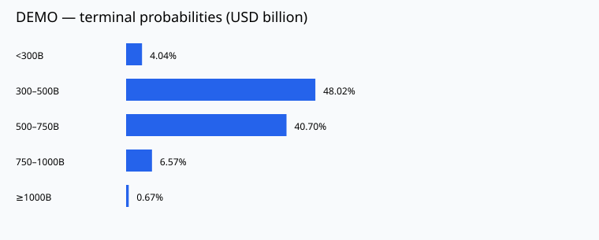

# Cognitive Forecasting Agent V1 研究报告

**DEMO / SYNTHETIC：以下全部事件和估值均为合成测试数据，不代表真实 OpenAI 预测。**

## 1. 任务与结算口径
- Run ID：`aa64a85defe54ab3941835b25b09b311`
- 问题：预测 OpenAI 在 2026 年 12 月 31 日的私募估值区间概率。
- 信息截止：2026-11-02T06:30:00+00:00
- 目标时点：2026-12-31T23:59:59-05:00
- 指标：private_company_equity_valuation_proxy；单位：USD billion；时区：America/New_York
- 规则来源：User research task: prompt.md sections 1.2 and 1.3; no contract verified
- 规则确认状态：research_definition_unverified_contract
- 边界：[lower, upper); final interval includes all finite values above its lower bound
- 数据缺失：refuse_without_sourced_anchor
- IPO：Private valuation metric becomes undefined after IPO; refuse if confirmed before target, revisit settlement definition.
- 更新规则：Timestamped public information only; no equivalence between Forge and NPM.
- 终点估值区间与期间最高值触及阈值不是同一预测任务。

## 2. 当前证据与来源

- **[988cfd703210cff5810a42ce] Assumption / financing** — SYNTHETIC OpenAI financing valued equity at USD 500 billion.
  - [DEMO / SYNTHETIC financing](https://synthetic.invalid/financing)；来源类型 unknown；可信度筛选分 0.45
  - 公开：2026-10-23 06:30:00+00:00；事件：2026-10-22 06:30:00+00:00；检索：2026-11-02 06:30:00+00:00；过时：False
- **[19c0b401db8decf9b0e9d270] Assumption / revenue** — SYNTHETIC enterprise subscription revenue increased; no actual financial disclosure.
  - [DEMO / SYNTHETIC revenue](https://synthetic.invalid/revenue)；来源类型 unknown；可信度筛选分 0.45
  - 公开：2026-10-27 06:30:00+00:00；事件：2026-10-26 06:30:00+00:00；检索：2026-11-02 06:30:00+00:00；过时：False
- **[d1f5738fe0c02f2d7cf8c045] Assumption / competition** — SYNTHETIC competitors cut prices, creating margin pressure.
  - [DEMO / SYNTHETIC competition](https://synthetic.invalid/competition)；来源类型 unknown；可信度筛选分 0.45
  - 公开：2026-10-25 06:30:00+00:00；事件：2026-10-24 06:30:00+00:00；检索：2026-11-02 06:30:00+00:00；过时：False
- **[876704c984c89203c691d08e] Assumption / profitability** — SYNTHETIC compute commitments raised costs and financing needs.
  - [DEMO / SYNTHETIC profitability](https://synthetic.invalid/profitability)；来源类型 unknown；可信度筛选分 0.45
  - 公开：2026-10-26 06:30:00+00:00；事件：2026-10-25 06:30:00+00:00；检索：2026-11-02 06:30:00+00:00；过时：False

## 3. 正面因素
- [988cfd703210cff5810a42ce] SYNTHETIC OpenAI financing valued equity at USD 500 billion.
- [19c0b401db8decf9b0e9d270] SYNTHETIC enterprise subscription revenue increased; no actual financial disclosure.

## 4. 负面因素
- [d1f5738fe0c02f2d7cf8c045] SYNTHETIC competitors cut prices, creating margin pressure.
- [876704c984c89203c691d08e] SYNTHETIC compute commitments raised costs and financing needs.

## 5. 可追溯因果假设
以下是机制假设，并非已经识别出的无偏因果效应。
### SYNTHETIC OpenAI financing valued equity at USD 500 billion.
- 路径：financing → Changes expected future cash flows or required return → May change terminal equity valuation
- 证据：988cfd703210cff5810a42ce；方向：positive；已计价可能性：possible
- 相反解释：Effect may already be priced in
- 不确定性：Impact magnitude is not calibrated
### SYNTHETIC enterprise subscription revenue increased; no actual financial disclosure.
- 路径：revenue → Changes expected future cash flows or required return → May change terminal equity valuation
- 证据：19c0b401db8decf9b0e9d270；方向：positive；已计价可能性：possible
- 相反解释：Effect may already be priced in
- 不确定性：Impact magnitude is not calibrated
### SYNTHETIC competitors cut prices, creating margin pressure.
- 路径：competition → Changes expected future cash flows or required return → May change terminal equity valuation
- 证据：d1f5738fe0c02f2d7cf8c045；方向：negative；已计价可能性：possible
- 相反解释：Effect may already be priced in
- 不确定性：Impact magnitude is not calibrated
### SYNTHETIC compute commitments raised costs and financing needs.
- 路径：profitability → Changes expected future cash flows or required return → May change terminal equity valuation
- 证据：876704c984c89203c691d08e；方向：negative；已计价可能性：possible
- 相反解释：Effect may already be priced in
- 不确定性：Impact magnitude is not calibrated

## 6. 信息缺口与独立审查
- No verified NPM/Forge terminal settlement quote
- 未取得配置口径下可验证的私募二级市场结算报价
- 争议/排除证据：[]
- 偏差：SYNTHETIC fixtures cannot establish real predictive accuracy
- 偏差：因果路径是模型假设；来源可信度不等于事件概率

## 7. 概率与无新闻基准

| 终点区间（USD billion） | 事件调整模型 | 无新闻基准 |
|---|---:|---:|
| <300B | 4.0400% | 3.6380% |
| 300–500B | 48.0240% | 46.5920% |
| 500–750B | 40.7040% | 41.9080% |
| 750–1000B | 6.5660% | 7.1200% |
| ≥1000B | 0.6660% | 0.7420% |



[交互式概率图](probabilities.html)

## 8. 数值计算与假设
```json
{
  "prior_assumptions": {
    "annual_log_volatility": 0.5,
    "annual_log_drift": 0.0,
    "years": 0.1640998998656425,
    "proxy_extra_log_sigma": 0.2,
    "seed": 42,
    "samples": 50000,
    "formula": "V_T = anchor * exp(drift*T + sqrt(vol^2*T + proxy_sigma^2)*Z + clipped(event_shift*scenario_factor))"
  },
  "baseline_valuation": 500.0,
  "baseline_source": "https://synthetic.invalid/financing",
  "baseline_evidence_id": "988cfd703210cff5810a42ce",
  "baseline_published_at": "2026-10-23T06:30:00+00:00",
  "event_adjustments": [
    {
      "event_key": "synthetic-revenue",
      "evidence_ids": [
        "19c0b401db8decf9b0e9d270"
      ],
      "log_shift": 0.0125,
      "reason": "Explicit heuristic log shift, discounted for possible prior pricing; NOT calibrated"
    },
    {
      "event_key": "synthetic-profitability",
      "evidence_ids": [
        "876704c984c89203c691d08e"
      ],
      "log_shift": -0.0125,
      "reason": "Explicit heuristic log shift, discounted for possible prior pricing; NOT calibrated"
    },
    {
      "event_key": "synthetic-financing",
      "evidence_ids": [
        "988cfd703210cff5810a42ce"
      ],
      "log_shift": 0.0,
      "reason": "At or before anchor publication: assumed embedded in baseline"
    },
    {
      "event_key": "synthetic-competition",
      "evidence_ids": [
        "d1f5738fe0c02f2d7cf8c045"
      ],
      "log_shift": -0.0125,
      "reason": "Explicit heuristic log shift, discounted for possible prior pricing; NOT calibrated"
    }
  ],
  "scenario_assumptions": {
    "effect_factors": [
      0,
      1,
      2
    ],
    "weights": [
      0.25,
      0.5,
      0.25
    ],
    "net_log_shift": -0.0125,
    "max_total_log_shift": 0.25,
    "interpretation": "Heuristic event effect absent / central / doubled, not estimated probabilities"
  },
  "posterior_distribution": [
    {
      "interval": "<300B",
      "probability": 0.0404
    },
    {
      "interval": "300–500B",
      "probability": 0.48024
    },
    {
      "interval": "500–750B",
      "probability": 0.40704
    },
    {
      "interval": "750–1000B",
      "probability": 0.06566
    },
    {
      "interval": "≥1000B",
      "probability": 0.00666
    }
  ],
  "baseline_distribution": [
    {
      "interval": "<300B",
      "probability": 0.03638
    },
    {
      "interval": "300–500B",
      "probability": 0.46592
    },
    {
      "interval": "500–750B",
      "probability": 0.41908
    },
    {
      "interval": "750–1000B",
      "probability": 0.0712
    },
    {
      "interval": "≥1000B",
      "probability": 0.00742
    }
  ],
  "median": 493.1089939996389,
  "interval_90": [
    308.5657332022558,
    791.3183371454892
  ],
  "uncertainty_notes": [
    "启发式预测；波动率、事件幅度和情景权重未经历史数据校准。",
    "可信度仅用于证据筛选，不被解释成事件发生概率。",
    "融资估值代理与私募二级市场结算价格不同。",
    "90% 区间为模型分布区间，不是经过验证的覆盖率承诺。"
  ],
  "rules_snapshot": {
    "forecast_type": "terminal_interval",
    "target_date": "2026-12-31T23:59:59-05:00",
    "valuation_metric": "private_company_equity_valuation_proxy",
    "unit": "USD_billion",
    "timezone": "America/New_York",
    "rules_status": "research_definition_unverified_contract",
    "market_rules_source": "User research task: prompt.md sections 1.2 and 1.3; no contract verified",
    "provider": "financing_proxy",
    "missing_data_rule": "refuse_without_sourced_anchor",
    "ipo_rule": "Private valuation metric becomes undefined after IPO; refuse if confirmed before target, revisit settlement definition.",
    "update_rule": "Timestamped public information only; no equivalence between Forge and NPM.",
    "boundary_rule": "[lower, upper); final interval includes all finite values above its lower bound",
    "intervals": [
      {
        "label": "<300B",
        "lower": 0.0,
        "upper": 300.0
      },
      {
        "label": "300–500B",
        "lower": 300.0,
        "upper": 500.0
      },
      {
        "label": "500–750B",
        "lower": 500.0,
        "upper": 750.0
      },
      {
        "label": "750–1000B",
        "lower": 750.0,
        "upper": 1000.0
      },
      {
        "label": "≥1000B",
        "lower": 1000.0,
        "upper": null
      }
    ]
  },
  "settings_snapshot": {
    "max_iterations": 2,
    "queries_per_round": 3,
    "max_search_calls": 9,
    "max_llm_calls": 10,
    "max_tokens": 250000,
    "max_output_tokens": 4000,
    "budget_usd": 2.0,
    "llm_usd_per_million_tokens": 5.0,
    "search_usd_per_call": 0.02,
    "search_retries": 1,
    "search_results": 5,
    "search_topic": "news",
    "max_documents_per_round": 8,
    "document_excerpt_chars": 5000,
    "retrieval_k": 16,
    "embedding_model": "hashing-char-1024",
    "seed": 42,
    "samples": 50000,
    "annual_log_volatility": 0.5,
    "annual_log_drift": 0.0,
    "proxy_extra_log_sigma": 0.2,
    "max_total_log_shift": 0.25,
    "event_log_shift": 0.025,
    "stale_days": 180,
    "database": "data/deliverable_demo.sqlite",
    "output_dir": "reports/demo_runs"
  }
}
```

## 9. 当前结论
模型中位数：**493.11 USD billion**；90% 模型区间：**[308.57, 791.32]**。
最终区间概率由固定种子的蒙特卡洛样本频率产生，不由 LLM 直接给定。

## 10. 局限性、预算与研究轨迹
- 启发式预测；波动率、事件幅度和情景权重未经历史数据校准。
- 可信度仅用于证据筛选，不被解释成事件发生概率。
- 融资估值代理与私募二级市场结算价格不同。
- 90% 区间为模型分布区间，不是经过验证的覆盖率承诺。
- 未核实真实 Polymarket 合约；使用配置的研究口径。
- 非校准启发式概率；不得解释成经过回测验证的后验。
- DEMO / SYNTHETIC：所有输入是合成测试数据；无真实 API 调用。
- 本轮未取得新内容，后续仅按已有证据推断。
- 研究预算/迭代限制或无新增查询，保留未解决的信息缺口。
- 状态流程：ParseQuestion → PlanResearch → Search → ProcessEvidence → RetrieveMemory → Reason → Critique → CheckInformationSufficiency → Search → ProcessEvidence → RetrieveMemory → Reason → Critique → CheckInformationSufficiency → UpdateBelief → GenerateForecast → GenerateReport → SaveRun
- 迭代次数：2
- 使用量（成本为配置估计，不是账单）：{'llm_calls': 0, 'search_calls': 0, 'reserved_tokens': 0, 'actual_tokens': 0, 'usage_reported': False, 'estimated_cost_usd': 0.0}

### 实际搜索记录
- {'query': 'OpenAI financing valuation', 'iteration': 1, 'count': 4, 'status': 'ok', 'time': '2026-11-02T06:54:54.640206+00:00'}
- {'query': 'OpenAI revenue compute costs', 'iteration': 1, 'count': 4, 'status': 'ok', 'time': '2026-11-02T06:54:54.640206+00:00'}
- {'query': 'OpenAI competition regulatory risks', 'iteration': 1, 'count': 4, 'status': 'ok', 'time': '2026-11-02T06:54:54.640206+00:00'}
- {'query': 'OpenAI NPM Forge valuation quote methodology', 'iteration': 2, 'count': 4, 'status': 'ok', 'time': '2026-11-02T06:54:54.714026+00:00'}
